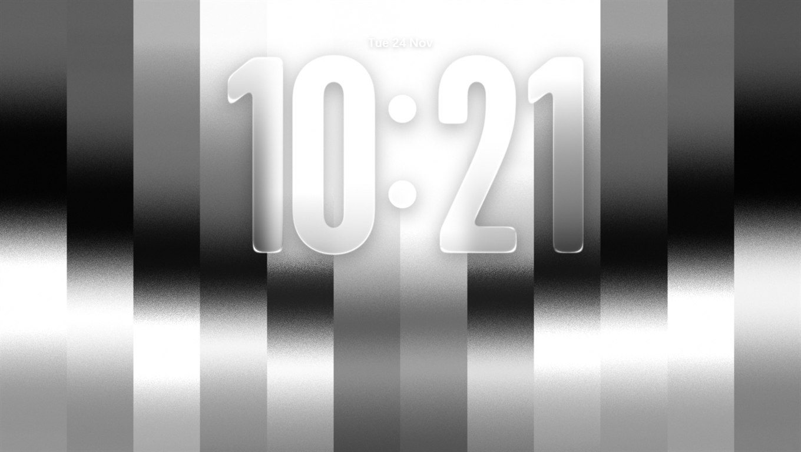
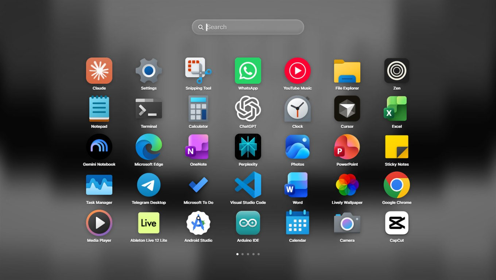
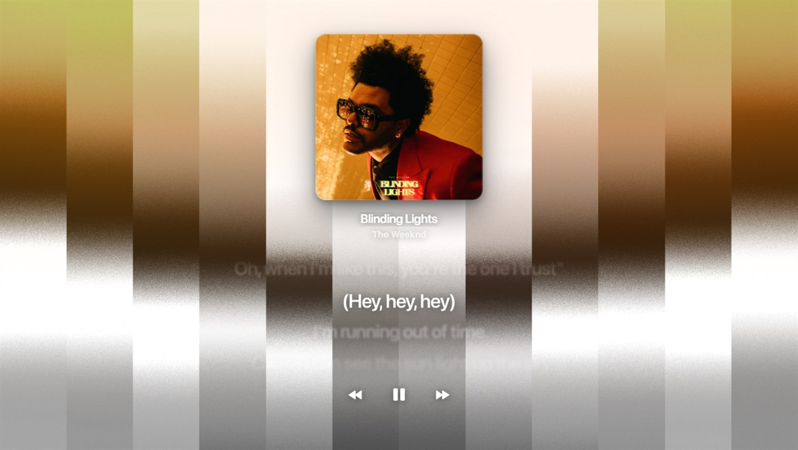
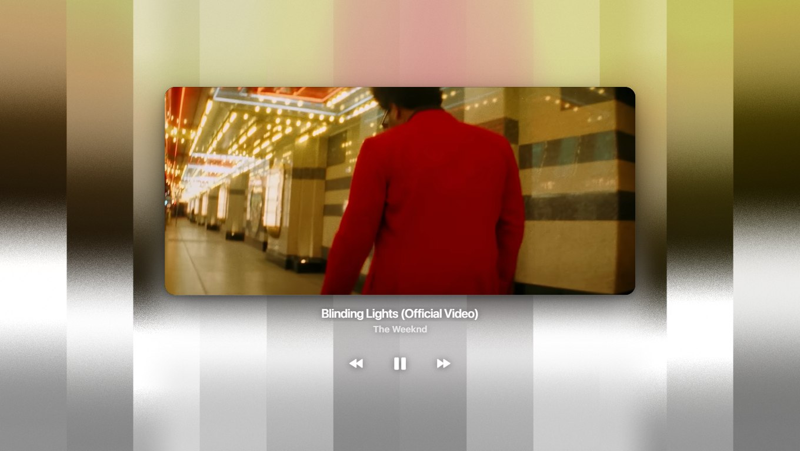
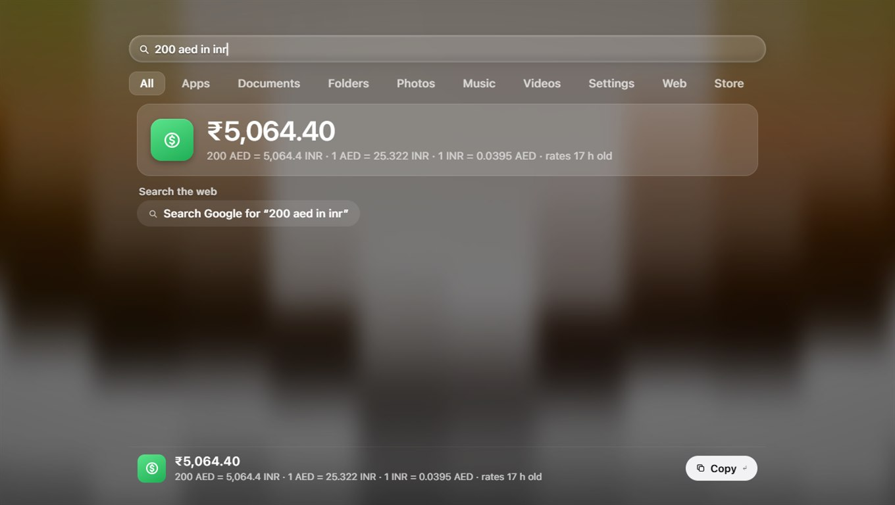

# Shadow Wallpaper

A live wallpaper for Windows 10/11: monochrome stripes that move with your mouse and bounce to your music, a liquid-glass clock, a Mac-style Launchpad with a smart search bar, and Apple Music-style live lyrics.

Runs on [Lively Wallpaper](https://www.rocksdanister.com/lively/) (installed for you if it's missing).

| | |
|---|---|
|  |  |
| **The clock** — liquid glass over stripes that move with your mouse | **Launchpad** — all your apps, sorted by use |
|  |  |
| **Now Playing** — the cover, time-synced lyrics, stripes lit in the cover's colour | **Music videos** — the video itself, in step with the music |
|  | |
| **Search** — answers right in Launchpad (`200 aed in inr`) | |

## Install

```powershell
winget install jeetkapiljain5-max.ShadowWallpaper
```

Then open **Shadow Wallpaper** from Start once: it sets everything up (and installs Lively Wallpaper if you don't have it).
A quiet install like winget's only puts the files in place; it also sets itself up the next time you sign in.

Or download `Shadow-Wallpaper-Setup-<version>.exe` from [Releases](../../releases) and run it - it offers to set up straight away.
It installs for your user only (no admin).

> **Tip:** for the cleanest look, pair it with [TranslucentTB](https://github.com/TranslucentTB/TranslucentTB), which makes the taskbar see-through:
> `winget install CharlesMilette.TranslucentTB`

## Controls

The wallpaper has three screens: **the clock**, **Now Playing** (when music is playing) and **Launchpad**.
Gestures work on the desktop itself: with no window in the way, or after clicking an empty part of it.

| | Trackpad | Mouse | Keyboard |
|---|---|---|---|
| **Open Launchpad** | Two-finger swipe left | Double-click an empty part of the desktop, or tilt the scroll wheel sideways | Windows key (opens it over your apps), or F4 on the desktop |
| **Close Launchpad** | Two-finger swipe right | Click outside the apps | Esc |
| **Launchpad pages** | Two-finger swipe left / right | Tilt the scroll wheel, or click the dots | ← → |
| **Clock → Now Playing** | Two-finger swipe right | Scroll down over the desktop | Alt + ↓ |
| **Now Playing → clock** | Two-finger swipe right | Scroll up over the desktop | Alt + ↑ |
| **Play / pause, next, previous** | | The buttons under the cover, or click the cover to play / pause | Your keyboard's media keys |

Double-clicking a desktop icon still just opens it; only a double-click on empty space opens Launchpad.

## What it does

**Wallpaper**
- Stripes that drift with the mouse, ripple when clicked and bounce with whatever is playing.
- A liquid-glass clock and date. Click the clock for a focus timer.

**Launchpad** — see [Controls](#controls) for every way to open it
- All your apps in a grid, sorted by how much you use them. Drag to rearrange, make folders, uninstall.
  An app that's already open is brought to the front instead of started again.
- Just start typing to search: apps, files, folders, photos, settings (including the old Control Panel pages,
  like `lid` for what closing the lid does), the Microsoft Store and the web, with actions for each result
  (open, open file location, run as administrator, pin to Start, ...). Arrow keys and Enter work throughout.
- The search also answers things: maths, currency (`200 aed in inr`), units, world time, weather, `define`,
  Wikipedia (`who was ada lovelace`), translation (`hello in japanese`), timer, stopwatch, battery, media keys.
- Music: `play` + any song, album or playlist plays it in YouTube Music.

**The Windows key** — opens Launchpad right over whatever you're doing (Win + any other key still works as normal)
- It pours up out of the bottom of the screen like the macOS genie, on its own live frosted glass; click outside it to close.
- Hover its bottom-right corner for power: sleep, lock, restart, shut down.
- Want Start back? Hover the bottom-right corner of the desktop Launchpad and click the Windows logo
  (blue = Windows' own Start, soft black = Launchpad). Ctrl + Esc always opens Start.

**Now Playing** — pick a song in the search, or just play one in YouTube Music, Spotify, or YouTube in your browser
- The clock turns into the cover, with time-synced lyrics underneath: YouTube Music's own synced lyrics for
  YouTube Music, [LRCLIB](https://lrclib.net) for everything else.
- Music videos and live performances play as the video itself (muted, in step with the music) in the middle,
  shaped to the video with no black bars. It's the exact video you're playing: taken from YouTube Music, or from the
  address bar for YouTube in a browser.
- Switch a song between **Song** and **Video** in YouTube Music and the wallpaper follows: the cover and lyrics for
  the song, the video on its own for the video.
- The stripes light up in the cover's main colour, or for a video, in the colours at its edges.
- Play / pause / next / previous under the cover. Pause, and the video pauses too.
- Whatever is playing wins: start Spotify while YouTube Music sits paused and the wallpaper switches to Spotify.
  Close the player and it goes back to the clock.

**Optional: your own YouTube Music library** — playlists and likes in the search. You create a free Google OAuth
"Desktop app" client (YouTube Data API v3), save its JSON as `google-client.json` in the app's `helper` folder,
then search `sign in to youtube music`. Your sign-in stays on your PC, encrypted with your Windows account.

## Fonts

The clock and Launchpad use Apple's SF Pro. It is **not** included: after install the app downloads it from
Apple onto your PC (about 220 MB, in the background). Until then, similar Windows fonts are used.

## Privacy

Everything runs on your PC. The helper listens only on `localhost`, protected by a random key made at install.
Network use: lyrics (LRCLIB), currency rates, weather, dictionary/Wikipedia/translation look-ups you type,
YouTube Music search and lyrics, YouTube (video player, preview frames), Apple (font download), and Google only if you sign in.
To know which video is playing, the helper reads the page address of YouTube Music, or of a browser tab playing YouTube,
through Windows' accessibility interface. That stays on your PC.

## Uninstall

Windows Settings → Apps → Shadow Wallpaper → Uninstall (or `winget uninstall jeetkapiljain5-max.ShadowWallpaper`).
